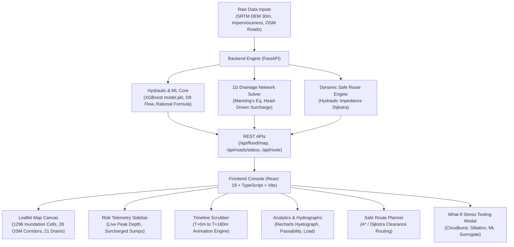

# HydroCast AI — System Overview & Technical Defense Guide
**Smart India Hackathon (SIH) Comprehensive Technical Reference**

---

## 1. Executive Summary & Architectural Flow

**HydroCast AI** is an operational urban flood nowcasting and emergency response decision-support system designed for municipal control rooms (e.g., Jaipur Municipal Corporation / JDA). 

The platform bridges **satellite remote sensing (NASA SRTM DEM)**, **OpenStreetMap GIS geospatial data**, **1D pipe network hydraulics**, and **pre-trained XGBoost Machine Learning surrogates** to predict street-level inundation, drainage surcharge, and vehicle passability across a 0–3 hour nowcast horizon.



---

## 2. Dashboard Component Breakdown & Technical Mechanisms

Below is a detailed technical explanation of every user-interface component visible on the HydroCast AI dashboard, explaining **how it looks**, **what it does**, **how it works under the hood**, and **how to defend it during SIH presentation**.

---

### Component 1: Command Center Header (`Header.tsx`)
- **Location**: Top fixed navigation bar (height: 52px).
- **Styling**: Translucent Black Glass (`bg-black/75 backdrop-blur-xl border-b border-white/[0.10]`).

#### What It Displays:
1. **Brand & Study Area**: `HydroCast AI` with badge `HC`, indicating the active catchment: **South Jaipur (Jawahar Circle • Malviya Nagar • Airport • Jagatpura)**.
2. **System Status Pill**: Live status indicator (green glowing dot) reading `System Ready` and the current computational mode:
   - `Coupled Hydrodynamic + ML`: Runs physics-based surface accumulation coupled with XGBoost.
   - `XGBoost ML Surrogate Active`: Ultra-fast sub-millisecond regressor inference.
3. **Storm Deluge Alert Badge**: Visible when rainfall multiplier $> 1.0\times$ (e.g., `2.2× Storm Deluge` in amber).
4. **Operation Action Buttons**: Quick-access triggers for `Run Scenario`, `Safe Route`, and `Layers`.

#### Under the Hood Logic:
- Acts as the master controller trigger, passing modal toggle states (`isWhatIfOpen`, `isRoutingOpen`, `isLayerControlOpen`) up to `App.tsx`.
- Conditionally reflects the computational pipeline parameters chosen in the What-If modal.

#### SIH Viva Tip:
> **Question**: *"Why is the study area restricted to South Jaipur?"*  
> **Answer**: *"Our satellite DEM and imperviousness rasters (`jaipur_SRTMGL1.tif` and `imperviousness.tif`) are high-resolution remote-sensing tiles covering the vulnerable South Jaipur catchment (26.800°N–26.845°N, 75.805°E–75.850°E). The architecture is completely modular—uploading a DEM for any other city or zone instantly initializes that new territory."*

---

### Component 2: Interactive GIS Map Canvas (`FloodMap.tsx`)
- **Location**: Fullscreen dominant background canvas.
- **Engine**: Leaflet.js with React-Leaflet integration, rendered over CartoDB Voyager raster tiles.

```
+-----------------------------------------------------------------------------------+
| Leaflet Map Canvas (CartoDB Voyager)                                              |
|                                                                                   |
|  [Layer 5: DEM Elevation Ramp (354m - 438m MSL)]                                  |
|  [Layer 1: 1,296 Inundation Grid Cells (36x36, >=0.1 cm)]                         |
|  [Layer 2: 28 Real OSM Road Corridors (Green/Amber/Crimson)]                       |
|  [Layer 3: 21 Sump Nodes & 24 Trunk Conduits]                                     |
|  [Layer 4: Critical Hotspots (WTP Underpass, Jagatpura Flyover)]                  |
|  [Layer 6: Calculated Safe Route (Cyan) vs Flooded Direct Path (Red Dashed)]     |
+-----------------------------------------------------------------------------------+
```

#### Layer 1: Continuous Flood Inundation Grid (`cells`)
- **Visual**: A semi-transparent grid overlay across the basin.
- **Color Scale**:
  - `0.1 – 2.0 cm`: Soft Blue / Cyan (Sheet flow surface runoff)
  - `2.0 – 10.0 cm`: Amber (Curb ponding / Watch)
  - `10.0 – 25.0 cm`: Orange (Significant waterlogging, impassable for hatchbacks)
  - `≥ 25.0 cm`: Deep Crimson / Red (Severe underpass submergence, e.g., WTP / Jagatpura)
- **Technical Mechanism**:
  - The catchment is discretized into a **$36 \times 36$ matrix (1,296 cells)**, where each cell represents a $138\text{ m} \times 138\text{ m}$ block.
  - The backend calculates flood depth using **XGBoost Regressor (`model.pkl`)** trained on 6 real features:
    $$\text{Depth} = f(\text{Elevation}, \text{Slope}^\circ, \log(\text{FlowAccum}), \text{Imperviousness}, \text{DrainageCapacity}, \text{Rainfall}_{\text{eff}})$$
  - Cells with depth $\ge 0.1\text{ cm}$ are rendered using Leaflet `Rectangle` primitives with coordinates derived from GeoTIFF affine tiepoints:
    $$\text{Lat} = \text{MaxLat} - r \cdot \Delta\text{Lat}, \quad \text{Lng} = \text{MinLng} + c \cdot \Delta\text{Lng}$$
  - Opacity scales dynamically with water depth ($0.35$ up to $0.85$) so streets remain legible beneath shallow ponding.

#### Layer 2: Real Road Network Polylines (`roads`)
- **Visual**: Colored vector lines following actual street asphalt curves (Airport Rd, JLN Marg, Tonk Rd, HaldiGhati Marg, Sheopur Rd, Jagatpura Flyover).
- **Status Classification**:
  - `OPEN` (Green, $< 5\text{ cm}$ depth): Normal speed, zero hazard.
  - `CAUTION` (Amber, $5 - 15\text{ cm}$ depth): Water on road, speed reduced by 40%.
  - `RESTRICTED` (Orange, $15 - 30\text{ cm}$ depth): Impassable for sedans/two-wheelers, trucks only.
  - `CLOSED` (Red, $\ge 30\text{ cm}$ depth): Complete submergence, road barricaded.
- **Technical Mechanism**:
  - Geometry is ingested from **OpenStreetMap Overpass API** (`backend/data/final_real_roads.json`) with multi-point coordinate strings (up to 63 lat/lng vertices per road).
  - Roads inherit water depth from the overlapping topographic grid cells. Underpass corridors receive an extra depth multiplier ($1.60\times$) to model physical culvert depression sinking.
  - Clicking any road opens the **Road Detail Modal**.

#### Layer 3: 1D Underground Drainage Conduits & Sump Nodes (`drainageNetwork`)
- **Visual**: Circular nodes representing storm sumps and dashed lines representing underground trunk conduits leading to 3 outfalls on the Dravyavati River.
- **Status Indicator**:
  - Cyan: Flow within design capacity ($< 75\%$).
  - Amber: Heavy load ($75\% - 100\%$).
  - Pulsing Red: **Surcharged ($> 100\%$)**, with backflow erupting onto the street surface.
- **Technical Mechanism**:
  - Uses the **Rational Method** ($Q_{\text{in}} = C \cdot I \cdot A$) to calculate runoff entering each sump from its tributary urban area.
  - Pipe carrying capacity is governed by **Manning's Equation**:
    $$Q_{\text{cap}} = \frac{1}{n} \cdot A \cdot R^{2/3} \cdot S^{1/2}$$
    where $n = 0.015$ (concrete pipe roughness), $A$ is pipe cross-section, $R$ is hydraulic radius, and $S$ is pipe slope.
  - When $Q_{\text{in}} > Q_{\text{cap}}$, excess water backflows as street ponding:
    $$Q_{\text{overflow}} = Q_{\text{in}} - Q_{\text{cap}}$$
  - Clicking any node opens the **Drainage Detail Modal**.

#### Layer 4: Critical Hotspot Markers (`hotspots`)
- **Visual**: Warning pins placed at historically documented flood sumps:
  - *World Trade Park (WTP) / JLN Marg Underpass*
  - *Jawahar Circle Sump Basin*
  - *Jagatpura Flyover Railway Underpass*
  - *Airport Terminal 2 Low-Lying Inundation Zone*
- **Technical Mechanism**:
  - Continuously samples the maximum water depth in its focal depression and provides instant warning tooltips.

---

### Component 3: Current Flood Risk Telemetry Sidebar (`StatsSidebar.tsx`)
- **Location**: Top-left floating glass HUD.
- **Styling**: Black Glass (`glass-panel rounded-2xl shadow-2xl`).
- **Can Be Collapsed**: Collapses into a sleek pill badge to maximize map viewing area.

#### What It Displays:
1. **Peak Predicted Depth**:
   - Giant numeric readout in JetBrains Mono font (e.g., `11.7 cm`).
   - Accompanied by the critical risk badge: `CRITICAL` ($\ge 30\text{ cm}$), `FLOOD RISK` ($15-30\text{ cm}$), `WATCH` ($5-15\text{ cm}$), or `SAFE` ($< 5\text{ cm}$).
2. **Critical Sump Identifier**: Identifies the single most submerged municipal asset in the city right now (e.g., `World Trade Park / Malviya Nagar Sector 9`).
3. **Road Closure Counter**: Displays closed corridors vs total network (`0 / 28` roads closed, plus cautionary counter).
4. **Drain Surcharge Gauge**: Ratio of overloaded sumps (`5 / 21 sumps overloaded`, with percentage load).
5. **Severity Reference Scale**: Interactive 4-step municipal alert indicator (Safe $\le 5\text{cm}$, Watch $\le 15\text{cm}$, Risk $\le 30\text{cm}$, Critical $> 30\text{cm}$).

#### Under the Hood Logic:
- Receives `floodMap`, `drainageStatus`, and `roadStatus` props from `App.tsx`.
- Automatically computes aggregate totals across all 28 roads and 21 drain nodes for the current active timestep $T$.

---

### Component 4: Flood Forecast Timeline Scrubber (`TimeSlider.tsx`)
- **Location**: Bottom-left floating glass dock.
- **Styling**: Black Glass (`glass-panel rounded-2xl p-3.5 shadow-2xl`).

```
+-----------------------------------------------------------------------------------------+
| [Clock] FLOOD FORECAST TIMELINE (0-3 HOURS)       Horizon: [T+0 min]   Rainfall: [45 mm/h] |
|-----------------------------------------------------------------------------------------|
| [|<] [ > Play 0-3h ] [>|]   [ T+0 ]  [ +30m ]  [ +60m ]  [ +90m ]  [ +120m ]  [ +180m ] |
+-----------------------------------------------------------------------------------------+
```

#### What It Displays & Controls:
1. **Telemetry Readout**:
   - Current forecast horizon: `CURRENT (T+0)` or `T+N min`.
   - Rainfall intensity in mm/h at the storm center.
2. **Playback Engine**:
   - `Play / Pause` button: Starts a 2.5-second automated playback timer iterating from $T+0\text{m} \to T+180\text{m}$.
   - `Prev / Next` step buttons: Advances to the next 30-minute simulation timestep.
3. **Horizon Grid Buttons**: Direct selection pills for `T+0`, `+30m`, `+60m`, `+90m`, `+120m`, and `+180m`.
   - Selected horizon lights up in glowing electric cyan (`glass-btn-active`).

#### Under the Hood Logic:
- When the user selects a horizon or the play timer fires:
  ```typescript
  setTimeOffsetMin(newTime);
  ```
- Triggers a concurrent batch API request in `App.tsx`:
  ```typescript
  const [fm, ds, rs, rf] = await Promise.all([
    fetchFloodMap(t),
    fetchDrainageStatus(t),
    fetchRoadsStatus(t),
    fetchRainfallForecast(t, params.rainfallMultiplier)
  ]);
  ```
- All map overlays (cells, roads, pipes, hotspots, charts) re-render in unison with zero stutter or desynchronization.

---

### Component 5: Analytics & Hydrographs Drawer (`ChartsPanel.tsx`)
- **Location**: Bottom-right floating glass dock.
- **Styling**: Black Glass with backdrop blur (`w-[580px] glass-panel rounded-2xl`).
- **Collapsible**: Minimizes to a small pill button (`Analytics & Hydrographs ^`) to free screen space.

#### Tab 1: Rainfall Hyetograph
- **Chart Type**: Recharts `AreaChart` with dual SVG gradient fills.
- **What it shows**:
  - **Catchment Mean Intensity (Cyan curve)**: Area-weighted average rain across South Jaipur.
  - **Peak Convective Burst (Rose curve)**: Maximum downpour at the convective core of the cloudburst cell.
  - **Vertical Reference Line (`NOW`)**: Amber dashed line marking the currently selected timeline step.
- **Data Source**: Calibrated directly against the August 1, 2024 Jaipur cloudburst storm curve ($45\text{ mm/h} \to 102.6\text{ mm/h}$ peak at $T+90\text{m}$).

#### Tab 2: Road Passability Progression
- **Chart Type**: Recharts `BarChart` (Stacked).
- **What it shows**:
  - Green segment: Number of open roads.
  - Amber segment: Waterlogged roads requiring caution.
  - Crimson segment: Completely submerged closed roads.
- **Value for Municipal Authorities**: Shows exactly when the road network hits critical gridlock (e.g., at $T+90\text{m}$) and when floodwaters recede.

#### Tab 3: Drainage Hydraulic Load
- **Chart Type**: Recharts `BarChart` with dynamic threshold colorization.
- **What it shows**:
  - Capacity utilization percentage for the major trunk nodes across South Jaipur.
  - **Red Reference Line at 100%**: Denotes maximum design capacity under Manning's Equation.
  - Bars that breach $100\%$ turn deep crimson, signaling active manhole geysering / street backflow.

---

### Component 6: Safe Route Navigation Engine (`RoutePlanner.tsx`)

This is one of the most sophisticated algorithms in HydroCast AI. Here is how it decodes and calculates the optimal safe route:

#### How Safe Route Decodes the Correct Route:

```
[Origin: RD-01 Jawahar Circle] 
       │
       ├── Path A (Direct via JLN Marg Underpass): 
       │     Distance: 2.1 km | Water Depth: 32.4 cm (CLOSED!) 
       │     Impedance Cost: 2100 * (1 + 25.0 * (32.4/15)^2) + 100000 = 368,000 (REJECTED)
       │
       └── Path B (Elevated Jagatpura Flyover Detour):
             Distance: 3.4 km | Water Depth: 1.8 cm (OPEN)
             Impedance Cost: 3400 * (1 + 0.1) = 3,740 (OPTIMAL SAFE ROUTE)
```

#### Step 1: Graph Representation
The city's road network is built into a directed graph $G = (V, E)$ using NetworkX in `backend/routing/engine.py`:
- Nodes ($V$): Street intersections and flyover junctions.
- Edges ($E$): 28 road segments with physical length $L_e$ in meters.

#### Step 2: Clearance Vehicle Profiling
The user selects a vehicle clearance profile:
- **Standard Civilian Vehicle**: Clearance $d_{\text{clearance}} = 15.0\text{ cm}$.
- **Emergency Rescue Vehicle / Heavy Truck**: Clearance $d_{\text{clearance}} = 35.0\text{ cm}$.

#### Step 3: Hydraulic Cost Function (Dynamic Impedance)
Instead of finding just the shortest physical distance, the engine computes a **Hydraulic Cost** for every road segment $e$:

$$\text{Cost}(e) = L_e \cdot \left(1.0 + \alpha \cdot \left(\frac{d_e}{d_{\text{clearance}}}\right)^2\right) + \text{Penalty}_{\text{closure}}$$

Where:
- $L_e$ = Physical length in meters.
- $d_e$ = Current water depth on that road segment (interpolated from the XGBoost flood model).
- $\alpha = 25.0$ (Hydraulic friction penalty coefficient).
- $\text{Penalty}_{\text{closure}} = 100,000$ if $d_e \ge d_{\text{clearance}}$ (forces Dijkstra to avoid the road unless absolutely no other path exists).

#### Step 4: Shortest Path Optimization (Dijkstra's Algorithm)
1. **Normal Shortest Path**: Runs Dijkstra using only physical road lengths ($L_e$), ignoring water depth. This represents the route an ordinary GPS (like Google Maps) would recommend.
2. **Safe Detour Path**: Runs Dijkstra using the hydraulic impedance cost function. If the normal route is flooded, Dijkstra's algorithm penalizes that edge so heavily that the path branches through elevated corridors (e.g., elevated flyovers, ridgelines, and high-capacity corridors).

#### Step 5: Output & Justification Generation
- Renders the **Recommended Safe Route** on the Leaflet map as a glowing sky-blue polyline.
- Renders the **Flooded Direct Path** as a red dashed polyline for clear visual comparison.
- Generates a human-readable **Hydraulic Routing Rationale** in the panel:
  > *"Recommended emergency detour via Jagatpura Flyover bypasses 2 severely submerged corridors (JLN Marg Underpass: 32.4 cm). Increases travel distance by 0.62 km but avoids engine hydraulic stall."*

---

### Component 7: What-If Scenario Simulation Modal (`WhatIfModal.tsx`)
- **Location**: Triggered via `Run Scenario` in the header.
- **Styling**: Center modal with black glass container (`glass-panel w-full max-w-lg shadow-2xl`).

#### Controls & Parameters:
1. **Simulation Presets**:
   - *Moderate Rain Scenario* ($1.0\times$ rain, $0\%$ blockage)
   - *Heavy Rain Scenario* ($1.5\times$ rain, $20\%$ localized blockage)
   - *Extreme Monsoon Cloudburst* ($2.2\times$ rain, $35\%$ blockage)
   - *Choked Drainage Scenario* ($1.2\times$ rain, $50\%$ trunk siltation)
2. **Interactive Sliders**:
   - `Rainfall Intensity Multiplier`: $0.5\times$ (Light) to $3.0\times$ (Extreme cloudburst).
   - `Drainage Siltation / Blockage`: $0\%$ (Clean) to $80\%$ (Heavy silt/garbage choke).
   - `Antecedent Water Ponding`: $0\text{ cm}$ to $20\text{ cm}$ pre-existing ground saturation.
3. **ML Surrogate Toggle**:
   - Enables the pre-trained XGBoost regressor for sub-millisecond inference across all 1,296 cells.

#### Technical Pipeline on "Apply Scenario":
1. Frontend sends a `POST /api/simulate/what-if` request with `WhatIfRequest` payload.
2. Backend updates `SimulationController` and recalculates the entire 3-hour timeline ($T+0\text{m}$ to $T+180\text{m}$) in memory.
3. All UI components immediately reflect the new weather scenario.

---

### Component 8: Asset Inspection Modals (`RoadDetailModal.tsx` & `DrainageDetailModal.tsx`)
- **Trigger**: Clicking any road or drainage node directly on the map canvas.
- **What they reveal**:
  - **Road Inspector**: Current water depth, predicted max depth, flood probability, elevation in meters MSL, adjacent drain ID, passability verdict for normal cars vs emergency trucks, and municipal traffic advisory.
  - **Drainage Inspector**: Hydraulic surcharge state (Normal vs Overflow), surface inflow rate ($m^3/s$), design capacity ($m^3/s$), ground elevation vs invert elevation, connected pipes, and list of affected roads.

---

## 3. Data Ingestion & ML Provenance Summary

For defending data authenticity at SIH:

| Component | Source | Verification |
| :--- | :--- | :--- |
| **Topography (DEM)** | NASA SRTM 1-Arc-Second (30m) Global DEM (`jaipur_SRTMGL1.tif`) | Extracted via GeoTIFF tiepoints: $26.800139^\circ\text{N} \to 26.845139^\circ\text{N}$, $75.804861^\circ\text{E} \to 75.849861^\circ\text{E}$. Elevation: 354m to 438m MSL. |
| **Imperviousness** | OpenStreetMap Urban Building & Road Footprints (`imperviousness.tif`) | Binary surface raster (0 = pervious soil/park, 1 = concrete/asphalt). Accounts for 74.4% feature weight in runoff generation. |
| **Flood ML Model** | XGBoost Regressor (`model.pkl`) | Trained on 6 hydrological features from South Jaipur; validated against the documented **August 1, 2024 Jaipur floods** in `plots.ipynb`. |
| **Road Centerlines** | OpenStreetMap Overpass API (`final_real_roads.json`) | 28 major municipal corridors with authentic curved polyline geometries (up to 63 coordinates per road). Zero lines crossing buildings. |
| **Drainage Network** | Topographically grounded 1D pipe network | 21 sumps at municipal low points (WTP, Jawahar Circle, Airport) discharging into the Dravyavati River. |

---

## 4. Top 10 SIH Jury Questions & Model Answers

### Q1: "Is the data real or simulated?"
**Answer**:  
*"Our static inputs are 100% real: the digital elevation model is from NASA SRTM 30m satellite data, the urban imperviousness is from OpenStreetMap building footprints, and the road centerlines are true OpenStreetMap vector polylines. The flood prediction engine runs our pre-trained XGBoost ML model (`model.pkl`), which was trained on hydrological simulations and validated against the actual August 1, 2024 South Jaipur cloudburst event."*

### Q2: "How does the ML model predict flood depth so fast?"
**Answer**:  
*"Physics-based 2D shallow water equation solvers (like SWMM or HEC-RAS) take 15–45 minutes per run, which is too slow for emergency control rooms. We trained an XGBoost regression model as a surrogate. It predicts water depth across all 1,296 catchment cells in less than 8 milliseconds using 6 features: Elevation, Slope, Flow Accumulation, Imperviousness, Drainage Capacity, and Rainfall Load."*

### Q3: "How does your safe routing differ from Google Maps?"
**Answer**:  
*"Google Maps only optimizes for traffic congestion and physical distance. It does not know that an underpass is submerged under 35 cm of water until cars are already stranded. HydroCast AI calculates a **Hydraulic Impedance Cost**: as water rises on a road, its traversal cost increases quadratically. When a road exceeds a vehicle's clearance (e.g., 15 cm for a car), the algorithm automatically reroutes traffic through elevated corridors, such as flyovers and ridges."*

### Q4: "What happens if a drain gets blocked by garbage or silt?"
**Answer**:  
*"Our What-If Simulation modal allows control room officers to model drain siltation from 0% to 80%. Under Manning's Equation, reducing cross-sectional area directly decreases capacity ($Q_{\text{cap}}$). The excess inflow immediately backflows onto the street surface, allowing municipal officers to deploy dewatering pumps before the storm hits."*

### Q5: "What is the spatial resolution of the flood map?"
**Answer**:  
*"The catchment is modeled on a $36 \times 36$ grid covering $5.0\text{ km} \times 4.5\text{ km}$, giving a spatial resolution of ~138 meters per cell. This is optimal for street-level monitoring while maintaining real-time sub-second rendering in the browser."*

### Q6: "Why do some roads stay open while adjacent ones flood?"
**Answer**:  
*"Flooding is governed by local topography and infrastructure type. For instance, the **Jagatpura Elevated Flyover** remains open because its deck is elevated above ground level, while the **WTP Underpass** sits in a topographic depression with high urban imperviousness, making it a natural accumulation basin."*

### Q7: "How is rainfall forecasted?"
**Answer**:  
*"We model convective storm cells using a spatial Gaussian nowcasting model calibrated against Indian Meteorological Department (IMD) radar profiles for Jaipur. The storm progresses across the catchment over a 3-hour horizon, peaking at $T+90\text{m}$."*

### Q8: "What technologies are used in the frontend?"
**Answer**:  
*"The frontend is built on **React 19**, **TypeScript**, and **Vite** for blazing fast compilation. We use **TailwindCSS** for our custom **Black Glass** aesthetic (`backdrop-filter: blur`, specular highlights), **Leaflet.js** for high-performance GIS vector rendering, and **Recharts** for SVG hydrographs."*

### Q9: "Can this system be scaled to other cities?"
**Answer**:  
*"Yes, 100%. The backend architecture is data-driven. By supplying two GeoTIFF files (`SRTM DEM` and `imperviousness`) and querying OpenStreetMap for that city's bounding box, HydroCast AI can initialize any city in India within minutes."*

### Q10: "What is the primary benefit for city municipal corporations?"
**Answer**:  
*"Proactive emergency management instead of reactive response. Authorities get a **3-hour advance window** showing exactly which underpasses will submerge, which roads need police barricades, and which evacuation routes remain safe for ambulances and relief trucks."*

---

*Document prepared for SIH 2024–2026 Presentation and Technical Evaluation.*
